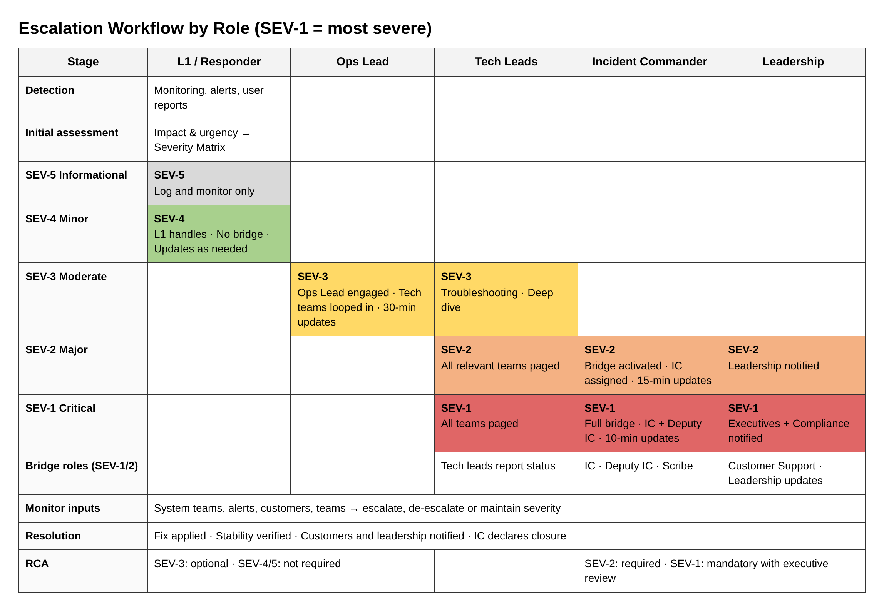
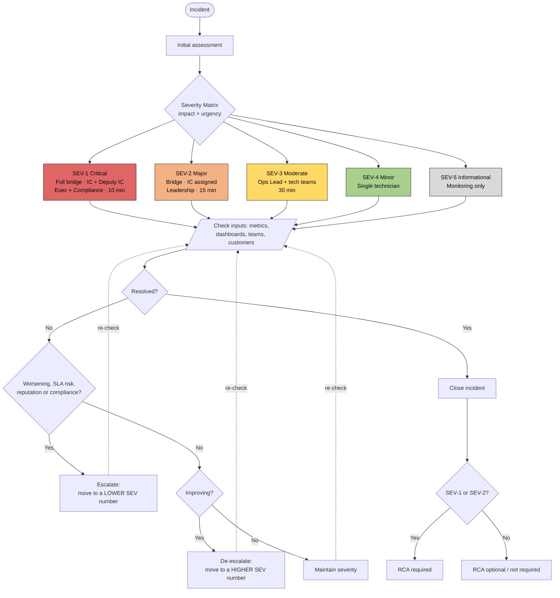

[← Back to README](README.md)

# Escalation Workflow

This workflow defines how incidents are escalated across the organization based on severity, business impact, urgency and customer impact.

- **Who does what at each severity:** [swimlane diagram](diagrams/escalation-workflow.png)
- **How severity changes during an incident:** [escalation path diagram](diagrams/escalation-path.png)
- **End-to-end lifecycle:** [incident lifecycle diagram](diagrams/incident-lifecycle.png)

---

## 1. Detection

Incidents may be detected through:
- Monitoring alerts (automated)
- User or customer reports
- System degradation
- Security tools
- Engineering notifications
- Third-party service alerts

Once detected, the responder performs an **initial assessment** and classifies severity using the [Severity Matrix](Severity-Matrix.md).

---

## 2. Severity Classification

Severity is determined by:
- **Impact:** None, Low, Moderate, High
- **Urgency:** Low, Medium, High, Immediate

This produces a SEV level (lower number = more severe):
- **SEV-1:** Critical
- **SEV-2:** Major
- **SEV-3:** Moderate
- **SEV-4:** Minor
- **SEV-5:** Informational

Severity determines the escalation path, communication cadence and bridge activation.

---

## 3. Escalation Triggers (By Severity Level)

### SEV-1 — Critical
- **Full incident bridge activated immediately**
- **Incident Commander + Deputy IC assigned**
- All technical teams paged
- Leadership + executive stakeholders notified
- Compliance notified (if regulated systems involved)
- Customer communication required
- Update cadence: every 10 minutes
- RCA mandatory, with executive review

### SEV-2 — Major
- **Bridge initiated**
- **Incident Commander assigned**
- All relevant technical teams paged
- Leadership notified
- Customer Support notified
- Customer communication may be required
- Update cadence: every 15 minutes
- RCA required

### SEV-3 — Moderate
- Notify Ops Lead
- Notify impacted technical teams (Network, Systems, VDI/EUC, Cloud, App)
- No bridge unless the issue worsens
- Customer Support notified if customer-facing
- Update cadence: every 30 minutes
- RCA optional

### SEV-4 — Minor
- Assigned to L1 or a single technical team
- No bridge
- No leadership notification
- No customer communication
- Update cadence: as needed

### SEV-5 — Informational
- Logged and monitored only
- No assignment unless it changes

---

## 4. Bridge Management (SEV-1 and SEV-2)

When a bridge is activated:
- IC takes command
- Deputy IC manages communication
- Scribe logs the timeline
- Technical leads provide updates
- Customer Support receives approved messaging
- Leadership receives business-impact summaries
- Compliance monitors regulatory exposure

The bridge remains active until:
- Service is restored
- Systems are stable
- IC declares closure

---

## 5. Communication Cadence (By Severity)

| Severity | Cadence | Audience |
|----------|---------|----------|
| SEV-1 | 10 min | All teams, leadership, executives, compliance |
| SEV-2 | 15 min | All teams, leadership, support |
| SEV-3 | 30 min | Ops Lead, technical teams |
| SEV-4 | As needed | Internal team |
| SEV-5 | None | Monitoring only |

[Communication templates](Communication-Template.md) must be used for:
- Initial notification
- Bridge initiation
- Status updates
- Customer updates
- Resolution
- Follow-up summary

---

## 6. Customer Impact Escalation

Customer communication is required when:
- Customers experience degradation
- The outage affects customer workflows
- SLA breach is likely
- Regulatory systems are impacted
- Executive leadership requests communication

Customer Support receives:
- Approved messaging
- Workarounds
- Update cadence
- Resolution notice
- Follow-up summary

---

## 7. Leadership & Executive Escalation

Leadership is notified for:
- SEV-1
- SEV-2
- SLA breach
- Financial impact
- Reputational risk

Executives are notified for:
- SEV-1
- Regulatory exposure
- Legal risk
- Public-facing outages
- Multi-region failures

---

## 8. Compliance Escalation

Compliance is notified when:
- Regulated systems are impacted
- Data exposure is suspected
- Downtime exceeds regulatory thresholds
- The incident may require external reporting

Compliance determines:
- Reporting requirements
- Documentation needs
- Regulatory communication timelines

---

## 9. Resolution

Resolution includes:
- Fix applied
- Confirmation of service restoration
- Stability verification
- Monitoring review
- Customer resolution communication
- Leadership resolution communication

The IC declares the incident closed.

---

## 10. RCA Requirement

| Severity | RCA required |
|----------|--------------|
| SEV-1 | Mandatory (executive review) |
| SEV-2 | Required |
| SEV-3 | Optional |
| SEV-4 | No |
| SEV-5 | No |

The RCA must follow the [RCA Template](RCA-Template.md) and include:
- Timeline
- Root cause
- Contributing factors
- Corrective actions
- Preventive actions
- Lessons learned
- Action items with follow-up dates

---

[← Back to README](README.md)
