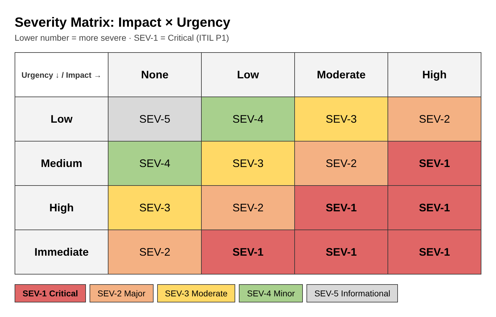

[← Back to README](README.md)

# Severity Classification Matrix (Impact × Urgency)

This matrix classifies incidents consistently across the organization. It turns **business impact** and **urgency** into a severity level from **SEV-1 (most severe)** to **SEV-5 (least severe)**.

**Lower number = higher severity.** This follows the common industry convention (for example PagerDuty and Atlassian incident levels) and lines up one-to-one with ITIL priorities P1–P5.

---

## 1. Severity Matrix Grid

| Urgency \ Impact | None | Low | Moderate | High |
|------------------|------|-----|----------|------|
| **Low**          | SEV-5 | SEV-4 | SEV-3 | SEV-2 |
| **Medium**       | SEV-4 | SEV-3 | SEV-2 | SEV-1 |
| **High**         | SEV-3 | SEV-2 | SEV-1 | SEV-1 |
| **Immediate**    | SEV-2 | SEV-1 | SEV-1 | SEV-1 |

---

## 2. Severity Definitions

**SEV-1 — Critical**
- Full outage or severe degradation of a critical service
- High business impact
- Regulatory or financial risk
- Executive and compliance notification required
- Full incident bridge with all teams

**SEV-2 — Major**
- Significant impact
- Large customer segment affected
- SLA breach likely
- Bridge initiated
- Incident Commander assigned

**SEV-3 — Moderate**
- Noticeable degradation
- Some customers affected
- SLA at risk
- Ops Lead and technical teams engaged

**SEV-4 — Minor**
- Low impact, no outage
- No SLA breach
- Handled by L1 or a single team

**SEV-5 — Informational**
- No customer impact or service degradation
- Logged and monitored for awareness only

---

## 3. Mapping to ITIL Priority

| Severity | ITIL priority | Name |
|----------|---------------|------|
| SEV-1 | P1 | Critical |
| SEV-2 | P2 | Major / High |
| SEV-3 | P3 | Moderate / Medium |
| SEV-4 | P4 | Minor / Low |
| SEV-5 | P5 | Informational / Planning |

Ticketing systems often use P1–P5 while incident teams say SEV-1–SEV-5. The numbers match, so a P1 ticket is a SEV-1 incident.

---

## 4. Why the Grid Uses Numbers

The grid **classifies** an incident; the definitions in section 2 **describe** what each level means. Keeping the grid numeric keeps it clean and fast to read during an incident, and the color coding carries the urgency at a glance.

Because the number goes **down** as severity goes **up**, "SEV-1" is universally understood as "the worst". Responders joining from other teams or companies won't misread it.

---

## 5. Color Coding

| Severity | Color | Hex |
|----------|-------|-----|
| SEV-1 | Red | `#E06666` |
| SEV-2 | Orange | `#F4B183` |
| SEV-3 | Yellow | `#FFD966` |
| SEV-4 | Green | `#A8D08D` |
| SEV-5 | Gray | `#D9D9D9` |

---

## 6. How to Use This Matrix During an Incident

1. **Determine impact:** None, Low, Moderate, High.
2. **Determine urgency:** Low, Medium, High, Immediate.
3. **Cross-reference the grid.** The cell is the SEV level.
4. **Trigger escalation** (details in the [Escalation Workflow](Escalation-Workflow.md)):
   - SEV-3 → Notify Ops Lead and technical teams
   - SEV-2 → Start bridge, assign Incident Commander
   - SEV-1 → Full bridge, leadership, executives and compliance
5. **Start the communication cadence:** every 10–30 minutes depending on severity.
6. **After resolution, complete the RCA:** required for SEV-1 and SEV-2.

---

[← Back to README](README.md)
